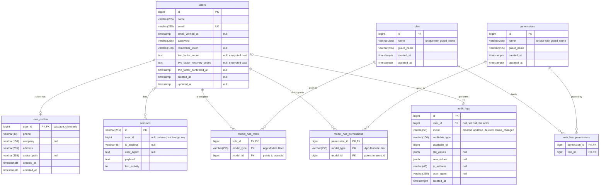
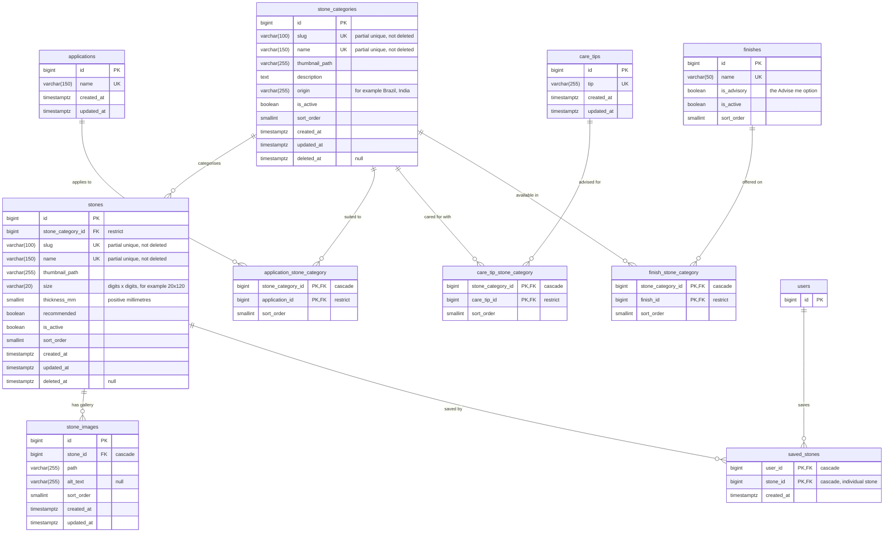
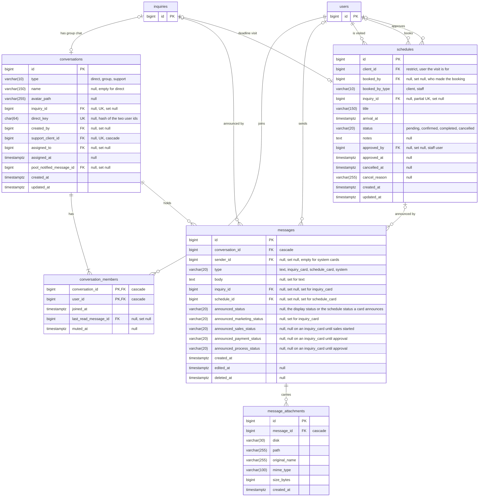

# Regray Studio: Production ERD (PostgreSQL)

This replaces the first draft. The database today only holds authentication, sessions, roles and permissions (the migrations). Everything else is mock data under `resources/js/data`, so those diagrams are **planned** schema. The repo targets **PostgreSQL** (`DB_CONNECTION=pgsql`), so the design uses `timestamptz`, partial unique indexes and CHECK constraints.

| Diagram                    | Status                                                                                                                                                     |
| -------------------------- | ---------------------------------------------------------------------------------------------------------------------------------------------------------- |
| 1. Auth, access and audit  | **Implemented** (Fortify, Spatie permission) and left exactly as it is. Only two new tables connect to it: `audit_logs` and `user_profiles` (clients only) |
| 2. Stone catalog           | Planned                                                                                                                                                    |
| 3. Portfolio and services  | Planned                                                                                                                                                    |
| 4. Inquiries               | Planned                                                                                                                                                    |
| 5. Messaging and schedules | Planned                                                                                                                                                    |

Not modeled yet on purpose: invoices. Quotations, job orders and receipts are files on the inquiry (`inquiry_files.document_type`), the quoted total and revision are columns of `inquiries`, and payments are a ledger (`payment_transactions`) beside accounting's hand-set payment status.

Not stored in the database on purpose: the inquiry draft (browser localStorage). Framework tables with no relations: `cache`, `cache_locks`, `jobs`, `job_batches`, `failed_jobs`, `password_reset_tokens`, `notifications`.

---

## Conventions applied to every table

- **Reading the diagrams.** A column is `NOT NULL` unless its comment starts with `null`. Every `id` is a `bigint` identity. Every timestamp in a new table is `timestamptz`, stored in UTC. The existing tables (`users`, `sessions`, Spatie) keep the column types they already have. Mermaid only shows PK, FK and UK, so indexes and CHECK rules are listed under each diagram.
- **Status fields** are `varchar(20)` with a CHECK listing the allowed values, mapped to a PHP backed enum. This avoids Postgres enum types, which are painful to alter.
- **Soft deletes** (`deleted_at`) on catalogs, projects, services, messages and uploaded files, so history keeps pointing at rows that were retired. Uniqueness on soft-deletable tables uses a **partial unique index** `WHERE deleted_at IS NULL`. Records that are never deleted: inquiries, status history, audit logs.
- **Foreign keys** are always declared with an explicit action: `CASCADE` for children a parent owns, `RESTRICT` for anything history depends on, `SET NULL` for "who did it" columns.
- **Files** are stored as `disk` + `path` (never a full URL), with original name, MIME type and size.
- **Normal form.** No JSON in business tables. The only JSON is `audit_logs` (an immutable log) and Laravel's own `notifications`. One deliberate exception: `stones.origin` is a free text field, so a stone with two origins is written as "Brazil, India".
- **Naming.** Plural snake_case tables, `{entity}_id` foreign keys, pivot tables named by the two singulars in alphabetical order, `sort_order` for display order, `is_` for booleans.

---

## 1. Auth, access and audit (implemented, untouched)

Roles come from `App\Enums\Role` (client, admin, owner, marketing, sales, accounting, technical, logistics) and permissions from `App\Enums\Permission`. The `users`, `sessions` and Spatie tables stay exactly as they are today: no new columns, no new indexes, no changed foreign keys. New tables may point at `users`, but `users` is never altered. A client's contact details live in the new one-to-one `user_profiles` table, which exists **only for users with the `client` role**.

| Table           | Indexes and rules                                                                                                                                                                                                                                                                                                                                                                                                                                                                            |
| --------------- | -------------------------------------------------------------------------------------------------------------------------------------------------------------------------------------------------------------------------------------------------------------------------------------------------------------------------------------------------------------------------------------------------------------------------------------------------------------------------------------------- |
| `users`         | Unchanged. Not altered by this design. A client is simply a user with the `client` role.                                                                                                                                                                                                                                                                                                                                                                                                     |
| `user_profiles` | Primary key and foreign key are the same column, so a user has at most one profile. FK `user_id` `CASCADE`. **Clients only**: staff and admins never get a row. A foreign key cannot say that, so the code that creates the profile (registration and the staff-created walk-in client) checks the `client` role, the same way `inquiries.client_id` is validated. `phone` and `address` are required because every client has them; `company` is optional (a private client may have none). |
| `sessions`      | Unchanged (existing indexes on `user_id` and `last_activity`, no foreign key).                                                                                                                                                                                                                                                                                                                                                                                                               |
| `audit_logs`    | Index `(auditable_type, auditable_id)`, index `(user_id, created_at)`, index `created_at`. Append only: no update or delete from the app.                                                                                                                                                                                                                                                                                                                                                    |
| Spatie tables   | Unchanged, including their composite primary keys. Do not add columns.                                                                                                                                                                                                                                                                                                                                                                                                                       |

---

## 2. Stone catalog

The catalogue has three levels: nine `stone_categories` (Granite, Marble and the other former stone types), individual named `stones`, and their `stone_images`. Description, origin, applications, care tips and finishes belong to the category and are shared by its stones. The legacy category thumbnail is retained; each individual stone has its own thumbnail, size, thickness and recommendation flag.

The 75 former image entries seed the individual stones, with one gallery image each. Sizes are placeholder data, rotated deterministically through `20x120`, `60x60`, `60x120`, and `80x80`; replace them with measured dimensions. Thickness and recommendation flags initially inherit their category's former values. Duplicate Monumental names are qualified with `(Monumental)` and their slugs with `-monumental` to preserve global name and slug uniqueness.

| Table                                                                                                     | Indexes and rules                                                                                                                                                                                                                                                               |
| --------------------------------------------------------------------------------------------------------- | ------------------------------------------------------------------------------------------------------------------------------------------------------------------------------------------------------------------------------------------------------------------------------- |
| `stone_categories`                                                                                        | Partial unique `lower(slug)` and `lower(name)` where `deleted_at IS NULL`, named `idx_stone_categories_*`. Index `(is_active, sort_order)`.                                                                                                                                     |
| `stones`                                                                                                  | Partial unique `lower(slug)` and `lower(name)` where `deleted_at IS NULL`. Index `(is_active, sort_order)`, `stone_category_id`, `size`, and `thickness_mm`. CHECK `size ~ '^[0-9]+x[0-9]+$'` and `thickness_mm > 0`. Category deletion is restricted while stones refer to it. |
| `stone_images`                                                                                            | Unique `(stone_id, sort_order)`.                                                                                                                                                                                                                                                |
| Pivots (`application_stone_category`, `care_tip_stone_category`, `finish_stone_category`, `saved_stones`) | Composite primary key as shown, plus a reverse index on the second column (`application_id`, `care_tip_id`, `finish_id`, `stone_id`). Shared facts refer to categories; saved stones refer to individual stones.                                                                |
| `finishes`                                                                                                | Unique `lower(name)`. Seed it from the current list (Leather, Honed, Polished, Advise me). Never hard delete a row an inquiry used: set `is_active = false`. Edge profiles are not tied to stones, so they are defined in the inquiries diagram.                                |

---

## 3. Portfolio and services

`projects` is the **portfolio** of finished work, not a client's inquiry project (those are in diagram 4). Home lists individual stones at `/home`; a stone is at `/home/{stone}`, and its published project highlights link to `/home/{stone}/{project}`. The project must be attached to that active stone. The `home.view` and `home-projects.view` guards remain independent. Project categories and their pivots are unchanged, but no longer filter Home.

Seed project `stone_slugs` remain legacy category references and expand to every individual stone in each category. Saved and inquiry category references resolve to the first individual stone by `sort_order`, then `id`.

| Table                | Indexes and rules                                                                                                                                                                                      |
| -------------------- | ------------------------------------------------------------------------------------------------------------------------------------------------------------------------------------------------------ |
| `projects`           | Partial unique `slug` where `deleted_at IS NULL`. Index `(is_published, completed_year DESC)`. CHECK `completed_year BETWEEN 1900 AND 2100`. Only published, non-deleted projects reach the Home page. |
| `project_images`     | Unique `(project_id, sort_order)`. The thumbnail lives in `projects.thumbnail_path` and is never repeated in the gallery.                                                                              |
| Pivots               | Composite primary key plus a reverse index on `stone_id` and `project_category_id`.                                                                                                                    |
| `project_categories` | Unique `slug` and `lower(name)`. Seeded with the nine categories.                                                                                                                                      |
| `services`           | Partial unique `slug` and `lower(name)` where `deleted_at IS NULL`. Index `(is_active, sort_order)`.                                                                                                   |
| `service_features`   | Unique `(service_id, sort_order)`.                                                                                                                                                                     |

---

## 4. Inquiries

A client (a user with the `client` role) sends an inquiry. **One inquiry is one project**: its name, location and the rest are columns of `inquiries`, and a client who wants another project opens another inquiry (the Inquire page opens one inquiry per project it sends). The same stone may appear in several rows of one inquiry only when its edge profile or finish differs. "Project" here always means the inquiry's own project; `projects` is the portfolio (section 3).

Each inquiry carries four **role statuses** and one **display status** that is calculated from them and never stored. **A role's status exists only once its stage has started**; until then it is NULL and nothing is shown for it. Marketing starts at creation (`pending`). Sales starts when marketing is won (`negotiation`). Accounting and logistics start together when the client approves the quotation, which sets sales to `quoted`: payment at `awaiting`, process at `received`. Until approval an inquiry shows only marketing and sales; from approval on, all four exist. Every role status change goes through `InquiryStatusService::transition()`, which updates the column and appends a history row on that track in the same transaction.

```mermaid
erDiagram
    inquiries {
        bigint id PK
        varchar(30) reference UK
        bigint client_id FK "restrict, user with the client role"
        varchar(100) name
        varchar(255) location
        varchar(150) landmark "null"
        decimal area_sqm "null, 10,2"
        varchar(1000) notes "null"
        varchar(20) marketing_status "default pending: pending, won, lost"
        timestamptz marketing_status_changed_at
        varchar(20) sales_status "null until marketing won: negotiation, site_visited, on_hold, quoted, rejected"
        timestamptz sales_status_changed_at "null"
        varchar(20) payment_status "null until approval: awaiting, partial, fully_paid"
        timestamptz payment_status_changed_at "null"
        varchar(20) process_status "null until approval: received ... completed, on_hold, delayed"
        timestamptz process_status_changed_at "null"
        decimal quoted_total "null, 12,2, above 0"
        smallint quote_revision "null, 1 and up"
        timestamptz created_at
        timestamptz updated_at
    }
    inquiry_handlers {
        bigint inquiry_id PK, FK "cascade"
        bigint user_id PK, FK "restrict, staff member"
        bigint assigned_by FK "null, set null"
        timestamptz assigned_at
    }
    inquiry_status_history {
        bigint id PK
        bigint inquiry_id FK "cascade"
        varchar(20) track "marketing, sales, payment, process"
        varchar(20) from_status "null, empty for a track's first entry"
        varchar(20) to_status "any role value"
        bigint changed_by FK "null, set null"
        varchar(500) note "null"
        timestamptz changed_at
    }
    inquiry_services {
        bigint inquiry_id PK, FK "cascade"
        bigint service_id PK, FK "restrict"
    }
    inquiry_categories {
        bigint inquiry_id PK, FK "cascade"
        bigint project_category_id PK, FK "restrict"
        smallint sort_order
    }
    inquiry_stones {
        bigint id PK
        bigint inquiry_id FK "cascade"
        bigint stone_id FK "restrict, individual stone"
        bigint edge_profile_id FK "restrict"
        bigint finish_id FK "restrict"
        smallint quantity "1 to 9999"
        smallint sort_order
        timestamptz created_at
        timestamptz updated_at
    }
    inquiry_files {
        bigint id PK
        bigint inquiry_id FK "cascade"
        varchar(30) document_type "client_attachment, quotation, receipt, job_order"
        smallint revision "null, 1 and up, a quotation's revision"
        varchar(30) disk
        varchar(255) path
        varchar(255) original_name
        varchar(100) mime_type
        bigint size_bytes
        char(64) sha256 "null"
        bigint uploaded_by FK "null, set null"
        timestamptz created_at
        timestamptz deleted_at "null"
    }
    payment_transactions {
        bigint id PK
        bigint inquiry_id FK "cascade"
        varchar(10) kind "payment, refund"
        decimal amount "12,2, above 0"
        varchar(60) reference "null"
        bigint recorded_by FK "null, set null"
        timestamptz received_at
        timestamptz created_at
    }
    users {
        bigint id PK
    }
    stones {
        bigint id PK
    }
    services {
        bigint id PK
    }
    project_categories {
        bigint id PK
    }
    edge_profiles {
        bigint id PK
        varchar(50) name UK
        boolean is_advisory "the Advise me option"
        boolean is_active
        smallint sort_order
    }
    finishes {
        bigint id PK
    }
    schedules {
        bigint id PK
        bigint inquiry_id FK "null, partial UK, set null"
    }

    users ||--o{ inquiries : "sends as client"
    inquiries ||--o{ inquiry_handlers : "assigned to"
    users ||--o{ inquiry_handlers : "handles"
    inquiries ||--|{ inquiry_status_history : "timeline, per track"
    inquiries ||--|{ inquiry_services : "wants"
    services ||--o{ inquiry_services : "requested in"
    inquiries ||--o{ inquiry_categories : "categorised"
    project_categories ||--o{ inquiry_categories : "chosen in"
    inquiries ||--o{ inquiry_stones : "specifies"
    stones ||--o{ inquiry_stones : "picked in"
    edge_profiles ||--o{ inquiry_stones : "cut with"
    finishes ||--o{ inquiry_stones : "finished as"
    inquiries ||--o{ inquiry_files : "carries"
    inquiries |o--o| schedules : "is booked as"
    inquiries ||--o{ payment_transactions : "is paid by"
    users |o--o{ inquiry_files : "uploads"
    users |o--o{ payment_transactions : "records"
```

| Table                    | Indexes and rules                                                                                                                                                                                                                                                                                                                                                                                                                                                                                                                                                                                                                                                                                                                                                                                                                                                                                                                                                                                                                                                                                                                                                                                                                                                                                                                                                                                                    |
| ------------------------ | -------------------------------------------------------------------------------------------------------------------------------------------------------------------------------------------------------------------------------------------------------------------------------------------------------------------------------------------------------------------------------------------------------------------------------------------------------------------------------------------------------------------------------------------------------------------------------------------------------------------------------------------------------------------------------------------------------------------------------------------------------------------------------------------------------------------------------------------------------------------------------------------------------------------------------------------------------------------------------------------------------------------------------------------------------------------------------------------------------------------------------------------------------------------------------------------------------------------------------------------------------------------------------------------------------------------------------------------------------------------------------------------------------------------- |
| `inquiries`              | Unique `reference`, from the `inquiry_reference_seq` sequence, never from `max(id)+1`. Index `client_id`, `marketing_status`, `sales_status`, `payment_status`, `process_status`. CHECK `marketing_status IN ('pending','won','lost')`, `sales_status IN ('negotiation','site_visited','on_hold','quoted','rejected')`, `payment_status IN ('awaiting','partial','fully_paid')`, `process_status IN ('received','measure','sourcing','production','quality_check','ready','dispatched','installation','completed','on_hold','delayed')`, `quoted_total > 0`, `quote_revision >= 1`. `marketing_status` is `NOT NULL`, default `pending`, with a `NOT NULL` `marketing_status_changed_at`. `sales_status`, `payment_status` and `process_status` are NULL with no default until their stage starts, as are their `*_changed_at`; each value CHECK applies only when the column is set. There is **no** CHECK that `payment_status` and `process_status` are NULL together: the app sets them together, and a test checks the seeded data. **No CHECK ties one column to another** (sales only after marketing won, sales quoted only with a quotation, payment and process only after approval, and so on): those are the flow's rules, kept in the app. Never deleted: cancel instead. `client_id` must belong to a user holding the `client` role; a foreign key cannot say that, so the form request validates it. |
| `inquiry_handlers`       | Index `user_id`.                                                                                                                                                                                                                                                                                                                                                                                                                                                                                                                                                                                                                                                                                                                                                                                                                                                                                                                                                                                                                                                                                                                                                                                                                                                                                                                                                                                                     |
| `inquiry_status_history` | Index `(inquiry_id, track, changed_at)`. Append only. CHECK `track IN ('marketing','sales','payment','process')`; `to_status` is in the union of every role's values, and `from_status` is NULL or in the same union. The value is **not** tied to its track by the database. Each inquiry's first entry is marketing `pending`, from NULL, at the time it was sent. The other tracks begin, from NULL, when their stage starts: sales `negotiation` when marketing is won, payment `awaiting` and process `received` when the client approves. A track has no entries while its column is NULL, and its last entry is its column's current value.                                                                                                                                                                                                                                                                                                                                                                                                                                                                                                                                                                                                                                                                                                                                                                   |
| `inquiry_stones`         | **Unique `(inquiry_id, stone_id, edge_profile_id, finish_id)`** (`idx_inquiry_stones_unique`): the same stone twice is fine only when cut or finished differently. Index `stone_id`. CHECK `quantity BETWEEN 1 AND 9999`.                                                                                                                                                                                                                                                                                                                                                                                                                                                                                                                                                                                                                                                                                                                                                                                                                                                                                                                                                                                                                                                                                                                                                                                            |
| `inquiry_files`          | Index `(inquiry_id, document_type)`. CHECK `document_type IN ('client_attachment','quotation','receipt','job_order')`, `revision >= 1`. A quotation file carries the `quote_revision` it was issued as. **Who uploads which** is the app's rule (`App\Policies\InquiryFileUploads`), not the database's: the inquiry's client uploads `client_attachment`, sales uploads `quotation` and `job_order`, accounting uploads `receipt`. Per inquiry limits (count and size) on client attachments are enforced in validation; an edit by the client only ever keeps or drops client attachments.                                                                                                                                                                                                                                                                                                                                                                                                                                                                                                                                                                                                                                                                                                                                                                                                                         |
| `payment_transactions`   | Index `(inquiry_id, received_at)`. CHECK `kind IN ('payment','refund')`, `amount > 0`. The ledger behind the payment status, which accounting sets **by hand**: it is not derived from these rows. The `payment` rows never add up to more than `quoted_total`; `awaiting` has none, `partial` has some, `fully_paid` adds up to `quoted_total`. A refund has no payment status of its own.                                                                                                                                                                                                                                                                                                                                                                                                                                                                                                                                                                                                                                                                                                                                                                                                                                                                                                                                                                                                                          |
| Pivots                   | `inquiry_services` and `inquiry_categories`, keyed on `inquiry_id`. Reverse index on `service_id` and `project_category_id`.                                                                                                                                                                                                                                                                                                                                                                                                                                                                                                                                                                                                                                                                                                                                                                                                                                                                                                                                                                                                                                                                                                                                                                                                                                                                                         |
| `edge_profiles`          | Unique `lower(name)`. Seed it with the 7 profiles plus Advise me. Never hard delete a row an inquiry used: set `is_active = false`.                                                                                                                                                                                                                                                                                                                                                                                                                                                                                                                                                                                                                                                                                                                                                                                                                                                                                                                                                                                                                                                                                                                                                                                                                                                                                  |

When the project is wanted is not a column: sending the inquiry books one schedule for it (`schedules.inquiry_id`, at most one per inquiry), and the target deadline is that schedule's `arrival_at`, read in Asia/Manila.

### The display status

The **inquiry status** is the one status shown for an inquiry everywhere: to the client and to staff, on every list, the details page, the thread card and the filters. It is the stage the inquiry has reached, not a summary. It is calculated, never stored: `App\Services\InquiryStatusCalculator::calculate()` in PHP, and the same rules as a SQL `CASE` (`InquiryStatusCalculator::sql()`, used by `Inquiry::scopeWithDisplayStatus`, `whereDisplayStatus` and `inStatusGroup`). A test checks the two agree on every combination.

The first rule that matches wins:

1. `cancelled` if `marketing_status` is `lost`, or `sales_status` is `rejected`;
2. `closed` if `process_status` is `completed`;
3. the logistics status (`process_status`) if the inquiry has a `job_order` file (`EXISTS (SELECT 1 FROM inquiry_files WHERE inquiry_files.inquiry_id = inquiries.id AND document_type = 'job_order' AND deleted_at IS NULL)`) and `process_status` is set;
4. the sales status (`sales_status`) if it is set;
5. `pending` otherwise (sales has not started).

NULL means the stage has not started. It is never a match (a SQL comparison with NULL is never true) and never appears on screen as a status: payment and logistics show nothing until they are set.

The values are used as they are: sales negotiation shows `negotiation`, sales quoted shows `quoted`, logistics production shows `production`. The display values are `pending`, `cancelled`, `closed`, `negotiation`, `site_visited`, `on_hold`, `quoted`, `received`, `measure`, `sourcing`, `production`, `quality_check`, `ready`, `dispatched`, `installation` and `delayed`. Accounting's `payment_status` is not part of it: it has a badge of its own beside the inquiry status.

The Quote list filters by group (`InquiryStatus::group()`): **pending** is display `pending`, **closed** is `closed`, **cancelled** is `cancelled`, and **in progress** is everything else.

### The flow

Written down here; **not built yet**. Nothing but the client's cancel moves a status today, and the seeded demo data is checked against these rules.

1. **New inquiry.** Marketing `pending`, with its first history row. Sales, payment and logistics are NULL.
2. **Marketing** engages the client first: `pending` → `won` (the client is engaged) or `lost` (the inquiry is dropped, and sales never starts).
3. **Sales** starts when marketing is won, in the same step, at `negotiation`, and talks with the client: `negotiation`, `site_visited`, `on_hold`.
4. **Issuing a quote.** Sales uploads the quotation file, increments `quote_revision` and sets `quoted_total`. Sales stays at `negotiation`. A revised quote does the same again.
5. **The client approves the quotation.** In one step, sales becomes `quoted`, payment becomes `awaiting` and process becomes `received`: accounting and logistics start together, and nothing else brings them into existence. Sales never sets `quoted` before the client has approved. Approval does not start the logistics steps: process stays at `received` until the job order is in.
6. **Job order.** After approval, sales uploads the `job_order` file. The inquiry now shows its logistics status. Sales stays `quoted`; there is no further sales value for it.
7. **Logistics**: `received` → `measure` → `sourcing` → `production` → `quality_check` → `ready` → `dispatched` → `installation` → `completed`. `delayed` and `on_hold` can be entered from any active step. `installation` is skipped when the job has none, and `completed` then follows `dispatched`. `completed` closes the inquiry.
8. **Accounting**, alongside logistics: `awaiting` → `partial` → `fully_paid` as payments arrive, each recorded as a `payment_transactions` row with its `receipt` file uploaded by accounting. Neither accounting nor logistics changes sales or marketing.
9. **Cancelled.** Sales `rejected` (the client turned the quotation down, or cancelled) or marketing `lost` shows `cancelled`. The client may cancel only **before approving the quotation**: Cancel is locked on their Quote card from sales `quoted` on, and the endpoint refuses it. A client's cancel sets `sales_status` to `rejected` if sales has started, and `marketing_status` to `lost` if it has not. **After approval only sales can cancel**, by setting sales to `rejected`, which shows the inquiry as `cancelled` (that sales action is not built yet). Either way the inquiry's open schedules are cancelled. Further conditions (for example, when logistics has been delayed too long) are not decided yet.

Every change to marketing, sales, payment or logistics posts an inquiry card with the new snapshot (section 5).

---

## 5. Messaging and schedules

A conversation is direct, a group, or a client's Regray Team thread (`support`), and a group may belong to an inquiry. Besides text, a message can be a **card** that points to an inquiry or a schedule and records what it announces, so "Booking pending" and "Booking approved" are two messages about one schedule. An **inquiry card** records a snapshot of the inquiry: its display status (`announced_status`) and its four role statuses, NULL for a stage that had not started.

| Table                  | Indexes and rules                                                                                                                                                                                                                                                                                                                                                                                                                                                                                                                                                                                                                                                                                                                                                                                                                                                                                                                                                                                                                                                                                                                                                                                                                                                                                                                                                                             |
| ---------------------- | --------------------------------------------------------------------------------------------------------------------------------------------------------------------------------------------------------------------------------------------------------------------------------------------------------------------------------------------------------------------------------------------------------------------------------------------------------------------------------------------------------------------------------------------------------------------------------------------------------------------------------------------------------------------------------------------------------------------------------------------------------------------------------------------------------------------------------------------------------------------------------------------------------------------------------------------------------------------------------------------------------------------------------------------------------------------------------------------------------------------------------------------------------------------------------------------------------------------------------------------------------------------------------------------------------------------------------------------------------------------------------------------- |
| `conversations`        | Unique `inquiry_id` (nullable), unique `direct_key` (nullable), unique `support_client_id` (nullable). CHECK `type IN ('direct','group','support')`, `(type = 'direct') = (direct_key IS NOT NULL)`, `inquiry_id IS NULL OR type = 'group'`, `(type = 'support') = (support_client_id IS NOT NULL)`, and the assignment pair. The unique `direct_key` stops two direct chats between the same two people.                                                                                                                                                                                                                                                                                                                                                                                                                                                                                                                                                                                                                                                                                                                                                                                                                                                                                                                                                                                     |
| `conversation_members` | Index `user_id`. Unread count = messages with `id` greater than `last_read_message_id`.                                                                                                                                                                                                                                                                                                                                                                                                                                                                                                                                                                                                                                                                                                                                                                                                                                                                                                                                                                                                                                                                                                                                                                                                                                                                                                       |
| `messages`             | Index `(conversation_id, id)`, index `inquiry_id`, index `schedule_id`. CHECK on `type` (`chk_messages_type`): `text` needs `body`; `inquiry_card` needs `inquiry_id`, `announced_status` in the display values (`pending`, `cancelled`, `closed`, `negotiation`, `site_visited`, `on_hold`, `quoted`, `received`, `measure`, `sourcing`, `production`, `quality_check`, `ready`, `dispatched`, `installation`, `delayed`) and `announced_marketing_status` (sales', payment's and process' snapshot columns are NULL until their stage started); `schedule_card` needs `schedule_id` and `announced_status` (a schedule status); `system` needs `system_event`. Every type but `inquiry_card` leaves the four snapshot columns NULL. CHECK each snapshot column against its role's values when set; `announced_status` has no table-wide CHECK, because its meaning depends on the type. A card is posted once per snapshot, so a retried listener cannot post it twice: partial unique `(conversation_id, inquiry_id, announced_status, announced_marketing_status, COALESCE(announced_sales_status, ''), COALESCE(announced_payment_status, ''), COALESCE(announced_process_status, '')) WHERE type = 'inquiry_card'` (the COALESCE makes a NULL match a NULL, which a plain unique index never does) and `(conversation_id, schedule_id, announced_status) WHERE type = 'schedule_card'`. |
| `message_attachments`  | Index `message_id`.                                                                                                                                                                                                                                                                                                                                                                                                                                                                                                                                                                                                                                                                                                                                                                                                                                                                                                                                                                                                                                                                                                                                                                                                                                                                                                                                                                           |
| `schedules`            | `client_id` is the user the visit is for, who holds the `client` role (validated in the form request). Index `(client_id, arrival_at)`, index `(status, arrival_at)`. **Partial unique `(inquiry_id) WHERE inquiry_id IS NOT NULL`** (`idx_schedules_inquiry_once`): an inquiry has one deadline visit, booked by `ScheduleService::createForInquiry()` when it is sent; a booking has no inquiry. CHECK `status IN ('pending','confirmed','completed','cancelled')`, `booked_by_type IN ('client','staff')`, and `approved_by IS NULL OR approved_at IS NOT NULL`. Cancelling an inquiry cancels its pending and confirmed schedule. A schedule starts as `pending` until Marketing or Sales approve it.                                                                                                                                                                                                                                                                                                                                                                                                                                                                                                                                                                                                                                                                                     |

An inquiry card is posted on any change to marketing, sales, payment or logistics, into the inquiry's group when it has one and otherwise into the client's Regray Team thread (`SupportConversationService::cardThreadFor`). The thread card shows the headline of the announced display status, the display status badge, then the payment status badge only when the snapshot has a payment status.

---

## Foreign key actions

| Action     | Used for                                                                                                                                                                                                                                                                                                                |
| ---------- | ----------------------------------------------------------------------------------------------------------------------------------------------------------------------------------------------------------------------------------------------------------------------------------------------------------------------- |
| `CASCADE`  | Rows a parent owns: images, features, all pivots, a client's profile, an inquiry's stones, files, status history and payment transactions, message attachments, conversation members and messages.                                                                                                                      |
| `RESTRICT` | Anything history depends on: `inquiry_stones` to stones, edge profiles and finishes, `inquiry_services` and `inquiry_categories` to their catalog rows, inquiries and schedules to the client's user, `inquiry_handlers` to users. Retire a catalog row with `is_active = false` or `deleted_at`, never by deleting it. |
| `SET NULL` | Every "who did it" column (`created_by`, `uploaded_by`, `changed_by`, `approved_by`, `booked_by`, `recorded_by`, `sender_id`, `last_read_message_id`), the link from a schedule to an inquiry, and from a card message to what it announces.                                                                            |

---

## What changed from the first draft

1. **Real types and sizes** on every column, `timestamptz` everywhere, and the precision for area.
2. **Soft deletes and partial unique indexes** on everything that can be retired, so slugs and names stay unique among live rows only.
3. **Every foreign key has an explicit action**, and "who did it" columns are nullable with `SET NULL`.
4. **Stones:** category → individual stone → gallery. Origin and shared facts belong to `stone_categories`; size and positive thickness in millimetres belong to `stones`. Project, saved and inquiry stone references now identify individual stones. "Advise me" is an `is_advisory` flag on finishes and edge profiles.
5. **No clients table.** A client is a user with the `client` role, and the contact fields live in `user_profiles` (clients only), so `users` stays untouched.
6. **Status history is complete**: `track`, `from_status`, `changed_by`, `note`, plus a `*_status_changed_at` for each role status.
7. **Schedules** separate who the visit is for (`client_id`) from who made the booking (`booked_by`, `booked_by_type`), and record cancellation.
8. **Messages**: cards are typed `inquiry_card` and `schedule_card` with an `announced_status`, protected by a CHECK. Added `message_attachments`, `edited_at` and `deleted_at`, and read tracking by `last_read_message_id`.
9. **Direct chats** cannot be duplicated (`direct_key`).
10. **Files** carry disk, MIME type, size and a checksum.
11. **Users, sessions and the Spatie tables are untouched.** New tables only connect to `users` by foreign key: `audit_logs`, and `user_profiles` for clients.
12. **Every list of rules** (indexes, CHECKs, partial uniques) is written down per diagram.

## Decisions to confirm

1. **`stone_categories.origin` is free text.** A category with several origins is written as "Brazil, India", which is not strictly third normal form. This was your call, and it keeps data entry simple.
2. **Thickness is one number.** The sample stones have ranges such as "50-100 mm" and "20-30 mm", so each needs a single value picked when the data is entered.
3. **Edge profiles are a separate lookup** used only by inquiries, with no link to stones.
4. **Client contact fields are in `user_profiles`** (`phone`, `company`, `address`, `avatar_path`), a one-to-one table used by clients only, because `users` must not change and staff do not need these fields.
5. **Locations stay free text.** `location` on projects and inquiries is a `varchar`. Add a `locations` table only if you need reporting by city.
6. **Staff titles** (Sales Officer, Technical Officer, and so on) are expected to be Spatie roles, not columns.
