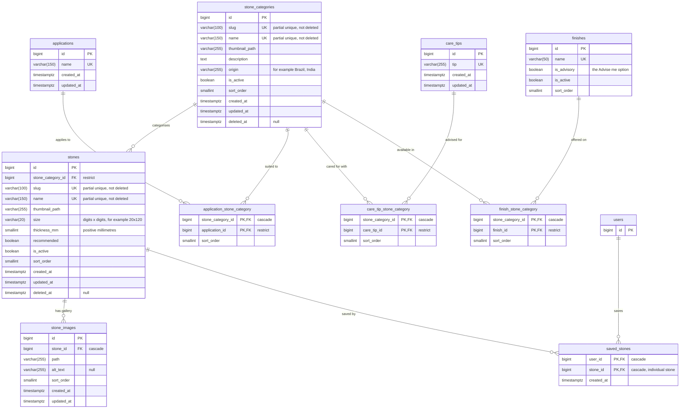
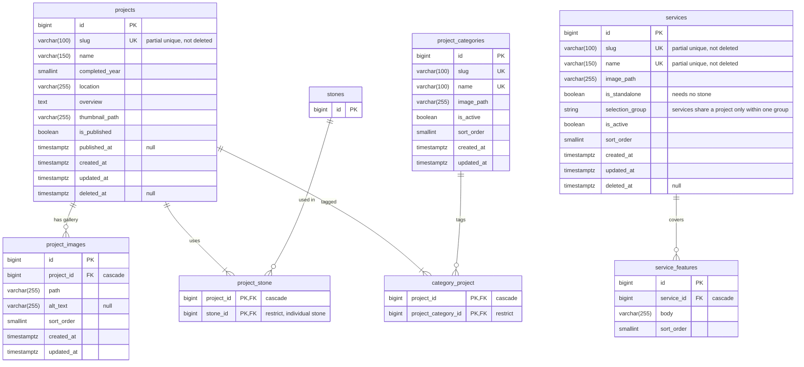
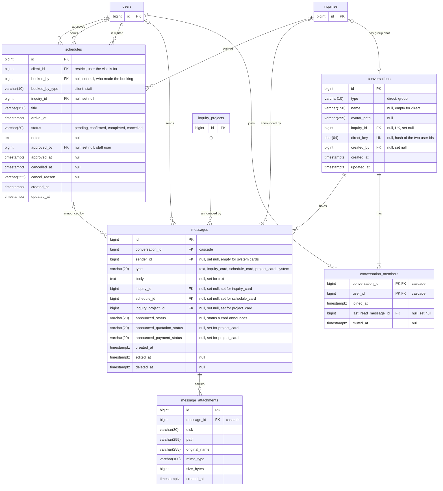

# Regray Studio: Production ERD (PostgreSQL)

This replaces the first draft. The database today only holds authentication, sessions, roles and permissions (the migrations). Everything else is mock data under `resources/js/data`, so those diagrams are **planned** schema. The repo targets **PostgreSQL** (`DB_CONNECTION=pgsql`), so the design uses `timestamptz`, partial unique indexes and CHECK constraints.

| Diagram                    | Status                                                                                                                                                     |
| -------------------------- | ---------------------------------------------------------------------------------------------------------------------------------------------------------- |
| 1. Auth, access and audit  | **Implemented** (Fortify, Spatie permission) and left exactly as it is. Only two new tables connect to it: `audit_logs` and `user_profiles` (clients only) |
| 2. Stone catalog           | Planned                                                                                                                                                    |
| 3. Portfolio and services  | Planned                                                                                                                                                    |
| 4. Inquiries               | Planned                                                                                                                                                    |
| 5. Messaging and schedules | Planned                                                                                                                                                    |

Not modeled yet on purpose: quotations, invoices and payments (to be designed later). The inquiry statuses `quoted` and `paid` exist, but no price or payment record sits behind them until then.

Not stored in the database on purpose: the inquiry draft (browser localStorage). Framework tables with no relations: `cache`, `cache_locks`, `jobs`, `job_batches`, `failed_jobs`, `password_reset_tokens`, `notifications`.

---

## Conventions applied to every table

- **Reading the diagrams.** A column is `NOT NULL` unless its comment starts with `null`. Every `id` is a `bigint` identity. Every timestamp in a new table is `timestamptz`, stored in UTC. The existing tables (`users`, `sessions`, Spatie) keep the column types they already have. Mermaid only shows PK, FK and UK, so indexes and CHECK rules are listed under each diagram.
- **Status fields** are `varchar(20)` with a CHECK listing the allowed values, mapped to a PHP backed enum. This avoids Postgres enum types, which are painful to alter.
- **Soft deletes** (`deleted_at`) on catalogs, projects, services, messages and uploaded files, so history keeps pointing at rows that were retired. Uniqueness on soft-deletable tables uses a **partial unique index** `WHERE deleted_at IS NULL`. Records that are never deleted: inquiries, status history, audit logs.
- **Foreign keys** are always declared with an explicit action: `CASCADE` for children a parent owns, `RESTRICT` for anything history depends on, `SET NULL` for "who did it" columns.
- **Files** are stored as `disk` + `path` (never a full URL), with original name, MIME type and size.
- **Normal form.** No JSON in business tables. The only JSON is `audit_logs` (an immutable log) and Laravel's own `notifications`. One deliberate exception: `stones.origin` is a free text field, so a stone with two origins is written as "Brazil, India".
- **Naming.** Plural snake_case tables, `{entity}_id` foreign keys, pivot tables named by the two singulars in alphabetical order, `sort_order` for display order, `is_` for booleans.

---

## 1. Auth, access and audit (implemented, untouched)

Roles come from `App\Enums\Role` (client, admin, owner, marketing, sales, accounting, technical, logistics) and permissions from `App\Enums\Permission`. The `users`, `sessions` and Spatie tables stay exactly as they are today: no new columns, no new indexes, no changed foreign keys. New tables may point at `users`, but `users` is never altered. A client's contact details live in the new one-to-one `user_profiles` table, which exists **only for users with the `client` role**.

| Table           | Indexes and rules                                                                                                                                                                                                                                                                                                                                                                                                                                                                            |
| --------------- | -------------------------------------------------------------------------------------------------------------------------------------------------------------------------------------------------------------------------------------------------------------------------------------------------------------------------------------------------------------------------------------------------------------------------------------------------------------------------------------------- |
| `users`         | Unchanged. Not altered by this design. A client is simply a user with the `client` role.                                                                                                                                                                                                                                                                                                                                                                                                     |
| `user_profiles` | Primary key and foreign key are the same column, so a user has at most one profile. FK `user_id` `CASCADE`. **Clients only**: staff and admins never get a row. A foreign key cannot say that, so the code that creates the profile (registration and the staff-created walk-in client) checks the `client` role, the same way `inquiries.client_id` is validated. `phone` and `address` are required because every client has them; `company` is optional (a private client may have none). |
| `sessions`      | Unchanged (existing indexes on `user_id` and `last_activity`, no foreign key).                                                                                                                                                                                                                                                                                                                                                                                                               |
| `audit_logs`    | Index `(auditable_type, auditable_id)`, index `(user_id, created_at)`, index `created_at`. Append only: no update or delete from the app.                                                                                                                                                                                                                                                                                                                                                    |
| Spatie tables   | Unchanged, including their composite primary keys. Do not add columns.                                                                                                                                                                                                                                                                                                                                                                                                                       |

---

## 2. Stone catalog

The catalogue has three levels: nine `stone_categories` (Granite, Marble and the other former stone types), individual named `stones`, and their `stone_images`. Description, origin, applications, care tips and finishes belong to the category and are shared by its stones. The legacy category thumbnail is retained; each individual stone has its own thumbnail, size, thickness and recommendation flag.

The 75 former image entries seed the individual stones, with one gallery image each. Sizes are placeholder data, rotated deterministically through `20x120`, `60x60`, `60x120`, and `80x80`; replace them with measured dimensions. Thickness and recommendation flags initially inherit their category's former values. Duplicate Monumental names are qualified with `(Monumental)` and their slugs with `-monumental` to preserve global name and slug uniqueness.

| Table                                                                                                     | Indexes and rules                                                                                                                                                                                                                                                               |
| --------------------------------------------------------------------------------------------------------- | ------------------------------------------------------------------------------------------------------------------------------------------------------------------------------------------------------------------------------------------------------------------------------- |
| `stone_categories`                                                                                        | Partial unique `lower(slug)` and `lower(name)` where `deleted_at IS NULL`, named `idx_stone_categories_*`. Index `(is_active, sort_order)`.                                                                                                                                     |
| `stones`                                                                                                  | Partial unique `lower(slug)` and `lower(name)` where `deleted_at IS NULL`. Index `(is_active, sort_order)`, `stone_category_id`, `size`, and `thickness_mm`. CHECK `size ~ '^[0-9]+x[0-9]+$'` and `thickness_mm > 0`. Category deletion is restricted while stones refer to it. |
| `stone_images`                                                                                            | Unique `(stone_id, sort_order)`.                                                                                                                                                                                                                                                |
| Pivots (`application_stone_category`, `care_tip_stone_category`, `finish_stone_category`, `saved_stones`) | Composite primary key as shown, plus a reverse index on the second column (`application_id`, `care_tip_id`, `finish_id`, `stone_id`). Shared facts refer to categories; saved stones refer to individual stones.                                                                |
| `finishes`                                                                                                | Unique `lower(name)`. Seed it from the current list (Leather, Honed, Polished, Advise me). Never hard delete a row an inquiry used: set `is_active = false`. Edge profiles are not tied to stones, so they are defined in the inquiries diagram.                                |

---

## 3. Portfolio and services

`projects` is the **portfolio** of finished work, not a client's inquiry project (those are in diagram 4). Home lists individual stones at `/home`; a stone is at `/home/{stone}`, and its published project highlights link to `/home/{stone}/{project}`. The project must be attached to that active stone. The `home.view` and `home-projects.view` guards remain independent. Project categories and their pivots are unchanged, but no longer filter Home.

Seed project `stone_slugs` remain legacy category references and expand to every individual stone in each category. Saved and inquiry category references resolve to the first individual stone by `sort_order`, then `id`.

| Table                | Indexes and rules                                                                                                                                                                                      |
| -------------------- | ------------------------------------------------------------------------------------------------------------------------------------------------------------------------------------------------------ |
| `projects`           | Partial unique `slug` where `deleted_at IS NULL`. Index `(is_published, completed_year DESC)`. CHECK `completed_year BETWEEN 1900 AND 2100`. Only published, non-deleted projects reach the Home page. |
| `project_images`     | Unique `(project_id, sort_order)`. The thumbnail lives in `projects.thumbnail_path` and is never repeated in the gallery.                                                                              |
| Pivots               | Composite primary key plus a reverse index on `stone_id` and `project_category_id`.                                                                                                                    |
| `project_categories` | Unique `slug` and `lower(name)`. Seeded with the nine categories.                                                                                                                                      |
| `services`           | Partial unique `slug` and `lower(name)` where `deleted_at IS NULL`. Index `(is_active, sort_order)`.                                                                                                   |
| `service_features`   | Unique `(service_id, sort_order)`.                                                                                                                                                                     |

---

## 4. Inquiries

A client (a user with the `client` role) sends one inquiry made of one or more inquiry projects. The same stone may appear in several rows of one project only when its edge profile or finish differs. Status changes go through one service class that updates `inquiries.status` and appends to the history in the same transaction.

Each project is worked separately: it has quotations (one row per revision), job orders and a payment, each with its own status, and the inquiry's status is read from its projects'. "Project" here always means `inquiry_projects`; `projects` is the portfolio (section 3).

```mermaid
erDiagram
    inquiries {
        bigint id PK
        varchar(30) reference UK
        bigint client_id FK "restrict, user with the client role"
        varchar(20) status "pending, ongoing, closed, lost"
        timestamptz status_changed_at
        timestamptz created_at
        timestamptz updated_at
    }
    inquiry_handlers {
        bigint inquiry_id PK, FK "cascade"
        bigint user_id PK, FK "restrict, staff member"
        bigint assigned_by FK "null, set null"
        timestamptz assigned_at
    }
    inquiry_status_history {
        bigint id PK
        bigint inquiry_id FK "cascade"
        varchar(20) from_status "null, empty for the first entry"
        varchar(20) to_status "draft, pending, ongoing, closed, lost"
        bigint changed_by FK "null, set null"
        varchar(500) note "null"
        timestamptz changed_at
    }
    inquiry_projects {
        bigint id PK
        bigint inquiry_id FK "cascade"
        varchar(100) name
        smallint sort_order
        varchar(255) location
        varchar(150) landmark "null"
        decimal area_sqm "null, 10,2"
        bigint schedule_id FK "null, UK, set null, holds the target deadline"
        varchar(1000) notes "null"
        varchar(20) status "pending, ongoing, closed, cancelled"
        timestamptz status_changed_at
        timestamptz created_at
        timestamptz updated_at
    }
    quotations {
        bigint id PK
        bigint inquiry_project_id FK "cascade"
        smallint revision_no "1 and up"
        varchar(20) status "pending, closeable, closed, revision, rejected"
        decimal total_amount "12,2, above 0"
        timestamptz issued_at
        timestamptz responded_at "null"
        bigint created_by FK "null, set null"
        timestamptz created_at
        timestamptz updated_at
    }
    job_orders {
        bigint id PK
        varchar(30) reference UK
        bigint inquiry_project_id FK "cascade"
        bigint quotation_id FK "restrict"
        varchar(20) status "pending, fabrication, for_install, for_delivery, for_pickup, delivered, installed, completed, on_hold, cancelled"
        timestamptz status_changed_at
        varchar(1000) notes "null"
        timestamptz created_at
        timestamptz updated_at
    }
    payments {
        bigint id PK
        bigint inquiry_project_id FK "cascade"
        bigint quotation_id FK "UK, restrict"
        decimal amount_due "12,2, above 0"
        decimal amount_paid "12,2, default 0"
        varchar(20) status "awaiting, partial, fully_paid, refunded"
        timestamptz status_changed_at
        timestamptz created_at
        timestamptz updated_at
    }
    payment_transactions {
        bigint id PK
        bigint payment_id FK "cascade"
        varchar(10) kind "payment, refund"
        decimal amount "12,2, above 0"
        varchar(60) reference "null"
        bigint recorded_by FK "null, set null"
        timestamptz received_at
        timestamptz created_at
    }
    inquiry_project_services {
        bigint inquiry_project_id PK, FK "cascade"
        bigint service_id PK, FK "restrict"
    }
    inquiry_project_categories {
        bigint inquiry_project_id PK, FK "cascade"
        bigint project_category_id PK, FK "restrict"
        smallint sort_order
    }
    inquiry_project_stones {
        bigint id PK
        bigint inquiry_project_id FK "cascade"
        bigint stone_id FK "restrict, individual stone"
        bigint edge_profile_id FK "restrict"
        bigint finish_id FK "restrict"
        smallint quantity "1 to 9999"
        smallint sort_order
        timestamptz created_at
        timestamptz updated_at
    }
    inquiry_files {
        bigint id PK
        bigint inquiry_project_id FK "cascade"
        varchar(30) disk
        varchar(255) path
        varchar(255) original_name
        varchar(100) mime_type
        bigint size_bytes
        char(64) sha256 "null"
        bigint uploaded_by FK "null, set null"
        timestamptz created_at
        timestamptz deleted_at "null"
    }
    users {
        bigint id PK
    }
    stones {
        bigint id PK
    }
    services {
        bigint id PK
    }
    project_categories {
        bigint id PK
    }
    edge_profiles {
        bigint id PK
        varchar(50) name UK
        boolean is_advisory "the Advise me option"
        boolean is_active
        smallint sort_order
    }
    finishes {
        bigint id PK
    }
    schedules {
        bigint id PK
    }

    users ||--o{ inquiries : "sends as client"
    inquiries ||--o{ inquiry_handlers : "assigned to"
    users ||--o{ inquiry_handlers : "handles"
    inquiries ||--|{ inquiry_status_history : "timeline"
    inquiries ||--|{ inquiry_projects : "contains"
    inquiry_projects ||--|{ inquiry_project_services : "wants"
    services ||--o{ inquiry_project_services : "requested in"
    inquiry_projects ||--o{ inquiry_project_categories : "categorised"
    project_categories ||--o{ inquiry_project_categories : "chosen in"
    inquiry_projects ||--o{ inquiry_project_stones : "specifies"
    stones ||--o{ inquiry_project_stones : "picked in"
    edge_profiles ||--o{ inquiry_project_stones : "cut with"
    finishes ||--o{ inquiry_project_stones : "finished as"
    inquiry_projects ||--o{ inquiry_files : "attaches"
    inquiry_projects |o--o| schedules : "is booked as"
    inquiry_projects ||--o{ quotations : "is quoted in"
    inquiry_projects ||--o{ job_orders : "is worked as"
    inquiry_projects ||--o{ payments : "is paid by"
    quotations ||--o{ job_orders : "carried out as"
    quotations ||--o| payments : "billed as"
    payments ||--o{ payment_transactions : "ledger"
    users |o--o{ quotations : "issues"
    users |o--o{ payment_transactions : "records"
```

| Table                    | Indexes and rules                                                                                                                                                                                                                                                                                                                                                                                                                                                                                             |
| ------------------------ | ------------------------------------------------------------------------------------------------------------------------------------------------------------------------------------------------------------------------------------------------------------------------------------------------------------------------------------------------------------------------------------------------------------------------------------------------------------------------------------------------------------- |
| `inquiries`              | Unique `reference`. Index `client_id`, index `(status, created_at DESC)`. CHECK `status IN ('pending','ongoing','closed','lost')`. Never deleted: cancel instead (the client cancelling makes it `lost`). `reference` comes from a database sequence, never from `max(id)+1`. `client_id` must belong to a user holding the `client` role. A foreign key cannot say that, so the form request validates it. A walk-in client is created by staff as a user account first.                                     |
| `inquiry_handlers`       | Index `user_id`.                                                                                                                                                                                                                                                                                                                                                                                                                                                                                              |
| `inquiry_status_history` | Index `(inquiry_id, changed_at)`. Append only. CHECK `to_status IN ('draft','pending','ongoing','closed','lost')`, and `from_status` is NULL or in the same list. `draft` is allowed in `to_status` only for the first entry.                                                                                                                                                                                                                                                                                 |
| `inquiry_projects`       | Unique `(inquiry_id, sort_order)`. Index `(inquiry_id, status)`. CHECK `status IN ('pending','ongoing','closed','cancelled')`; `status_changed_at` is the time of the last change, and a new project starts `pending`. Unique `schedule_id` (nullable). A project has no deadline columns of its own: sending the inquiry creates one schedule per project, and the target deadline is that schedule's `arrival_at` (read in Asia/Manila). `schedule_id` is null only for projects that never had a date.     |
| `inquiry_project_stones` | **Unique `(inquiry_project_id, stone_id, edge_profile_id, finish_id)`**: the same stone twice is fine only when cut or finished differently. Index `stone_id`. CHECK `quantity BETWEEN 1 AND 9999`.                                                                                                                                                                                                                                                                                                           |
| `quotations`             | Unique `(inquiry_project_id, revision_no)`. **Partial unique `(inquiry_project_id) WHERE status IN ('pending','closeable','closed')`** (`idx_quotations_one_live`): one live quotation per project. CHECK `revision_no >= 1`, `total_amount > 0`, and `status IN ('pending','closed','revision','closeable','rejected')`. A pending revision becomes `revision` when a newer revision replaces it.                                                                                                            |
| `job_orders`             | Unique `reference`, taken from the `job_order_reference_seq` sequence, never from `max(id)+1`. Index `inquiry_project_id`, index `quotation_id`, index `status`. CHECK on the ten statuses. Only written against a `closeable` or `closed` quotation.                                                                                                                                                                                                                                                         |
| `payments`               | **Unique `quotation_id`**: one payment record per quotation. Index `inquiry_project_id`. CHECK `amount_due > 0`, `amount_paid >= 0 AND amount_paid <= amount_due`, `status IN ('awaiting','partial','fully_paid','refunded')`, and the status agrees with the amounts: `awaiting` has `amount_paid = 0`, `partial` has `0 < amount_paid < amount_due`, `fully_paid` has `amount_paid = amount_due`. `amount_due` is the quotation's `total_amount`. Only written against a `closeable` or `closed` quotation. |
| `payment_transactions`   | Index `(payment_id, received_at)`. CHECK `kind IN ('payment','refund')`, `amount > 0`. `payments.amount_paid` is the sum of the payment's `payment` rows; a refund is recorded as its own row and leaves `amount_paid` as it was.                                                                                                                                                                                                                                                                             |
| `inquiry_files`          | Index `inquiry_project_id`. Per project limits (count and size) are enforced in validation.                                                                                                                                                                                                                                                                                                                                                                                                                   |
| Pivots                   | Reverse index on `service_id` and `project_category_id`.                                                                                                                                                                                                                                                                                                                                                                                                                                                      |
| `edge_profiles`          | Unique `lower(name)`. Seed it with the 7 profiles plus Advise me. Never hard delete a row an inquiry used: set `is_active = false`.                                                                                                                                                                                                                                                                                                                                                                           |

### Status rules

Only the data follows these rules so far: nothing moves a status along them yet.

- **Project.** Starts `pending`. Becomes `ongoing` once work has started: the quotation drives it first, and job orders and the payment are tracked alongside. `cancelled` when any one of these happens: the quotation is rejected, the payment is refunded, or a job order is cancelled. `closed` when all of these hold: the quotation is closed, the payment is fully paid, and every job order is completed.
- **Inquiry**, from its projects. `lost` when every project is cancelled. `closed` when no project is pending or ongoing and at least one is closed. `pending` while every project is still pending. Otherwise `ongoing`: at least one project is ongoing, or some are still pending while others are closed or cancelled.
- **Quotation.** `pending` (sent, waiting on the client) → `closeable` (accepted) → `closed`. A pending quotation can instead become `revision` (replaced by a newer revision row) or `rejected`.
- **Job order.** fabrication → for_install → installed → completed; fabrication → for_delivery → delivered → completed; fabrication → for_pickup → delivered → completed. `on_hold` from any active status; `cancelled` from any status before `completed`.
- **Payment.** awaiting → partial → fully_paid; partial or fully_paid → refunded.

---

## 5. Messaging and schedules

A conversation is direct or a group, and a group may belong to an inquiry. Besides text, a message can be a **card** that points to an inquiry, a schedule or an inquiry project and records which status it announces (so "Booking pending" and "Booking approved" are two messages about one schedule). A project card records a snapshot of three statuses: the project's, its quotation's and its payment's.

| Table                  | Indexes and rules                                                                                                                                                                                                                                                                                                                                                                                                                                                                                                                                                                                                                                                                                                                                                                                                                                                                                                                                                                                                                                          |
| ---------------------- | ---------------------------------------------------------------------------------------------------------------------------------------------------------------------------------------------------------------------------------------------------------------------------------------------------------------------------------------------------------------------------------------------------------------------------------------------------------------------------------------------------------------------------------------------------------------------------------------------------------------------------------------------------------------------------------------------------------------------------------------------------------------------------------------------------------------------------------------------------------------------------------------------------------------------------------------------------------------------------------------------------------------------------------------------------------- |
| `conversations`        | Unique `inquiry_id` (nullable), unique `direct_key` (nullable). CHECK `type IN ('direct','group')`, `(type = 'direct') = (direct_key IS NOT NULL)`, and `inquiry_id IS NULL OR type = 'group'`. The unique `direct_key` stops two direct chats between the same two people.                                                                                                                                                                                                                                                                                                                                                                                                                                                                                                                                                                                                                                                                                                                                                                                |
| `conversation_members` | Index `user_id`. Unread count = messages with `id` greater than `last_read_message_id`.                                                                                                                                                                                                                                                                                                                                                                                                                                                                                                                                                                                                                                                                                                                                                                                                                                                                                                                                                                    |
| `messages`             | Index `(conversation_id, id DESC)`. CHECK on `type`: `text` needs `body`, `inquiry_card` needs `inquiry_id` and `announced_status`, `schedule_card` needs `schedule_id` and `announced_status`, `project_card` needs `inquiry_project_id`, `announced_status` (the project status), `announced_quotation_status` and `announced_payment_status`, and no other combination of those columns may be set: every other type leaves the three project columns NULL. CHECK `announced_quotation_status` and `announced_payment_status` against their status lists when set. Index `schedule_id`, index `inquiry_id`, index `inquiry_project_id`. A card is posted once per snapshot, so a retried listener cannot post it twice: partial unique `(conversation_id, inquiry_id, announced_status) WHERE type = 'inquiry_card'`, `(conversation_id, schedule_id, announced_status) WHERE type = 'schedule_card'`, and `(conversation_id, inquiry_project_id, announced_status, announced_quotation_status, announced_payment_status) WHERE type = 'project_card'`. |
| `message_attachments`  | Index `message_id`.                                                                                                                                                                                                                                                                                                                                                                                                                                                                                                                                                                                                                                                                                                                                                                                                                                                                                                                                                                                                                                        |
| `schedules`            | `client_id` is the user the visit is for, who holds the `client` role (validated in the form request). Index `(client_id, arrival_at)`, index `(status, arrival_at)`, index `inquiry_id`. CHECK `status IN ('pending','confirmed','completed','cancelled')`, `booked_by_type IN ('client','staff')`, and `approved_by IS NULL OR approved_at IS NOT NULL` (an approver always has a time; the reverse is allowed so that `ON DELETE SET NULL` on the approver never violates the rule). Posting a schedule card is done by the same service that changes `schedules.status`. `inquiry_id` is set on the schedules an inquiry creates (one per project, pointed at by `inquiry_projects.schedule_id`) and NULL on a booking, which is never linked to an inquiry project. Cancelling an inquiry cancels its pending and confirmed schedules. A schedule starts as `pending` until Marketing or Sales approve it.                                                                                                                                            |

---

## Foreign key actions

| Action     | Used for                                                                                                                                                                                                                                                                                                 |
| ---------- | -------------------------------------------------------------------------------------------------------------------------------------------------------------------------------------------------------------------------------------------------------------------------------------------------------- |
| `CASCADE`  | Rows a parent owns: images, features, all pivots, a client's profile, an inquiry's projects and their stones, files, quotations, job orders and payments, a payment's transactions, message attachments, conversation members and messages.                                                              |
| `RESTRICT` | Anything history depends on: `inquiry_project_stones` to stones, edge profiles and finishes, inquiries and schedules to the client's user, `inquiry_handlers` to users, job orders and payments to their quotation. Retire a catalog row with `is_active = false` or `deleted_at`, never by deleting it. |
| `SET NULL` | Every "who did it" column (`created_by`, `uploaded_by`, `changed_by`, `approved_by`, `booked_by`, `recorded_by`, `sender_id`, `last_read_message_id`), the link from a schedule to an inquiry, from an inquiry project to its schedule, and from a card message to what it announces.                    |

---

## What changed from the first draft

1. **Real types and sizes** on every column, `timestamptz` everywhere, and the precision for area.
2. **Soft deletes and partial unique indexes** on everything that can be retired, so slugs and names stay unique among live rows only.
3. **Every foreign key has an explicit action**, and "who did it" columns are nullable with `SET NULL`.
4. **Stones:** category → individual stone → gallery. Origin and shared facts belong to `stone_categories`; size and positive thickness in millimetres belong to `stones`. Project, saved and inquiry stone references now identify individual stones. "Advise me" is an `is_advisory` flag on finishes and edge profiles.
5. **No clients table.** A client is a user with the `client` role, and the contact fields live in `user_profiles` (clients only), so `users` stays untouched.
6. **Status history is complete**: `from_status`, `changed_by`, `note`, plus `inquiries.status_changed_at`.
7. **Schedules** separate who the visit is for (`client_id`) from who made the booking (`booked_by`, `booked_by_type`), and record cancellation.
8. **Messages**: cards are typed `inquiry_card` and `schedule_card` with an `announced_status`, protected by a CHECK. Added `message_attachments`, `edited_at` and `deleted_at`, and read tracking by `last_read_message_id`.
9. **Direct chats** cannot be duplicated (`direct_key`).
10. **Files** carry disk, MIME type, size and a checksum.
11. **Users, sessions and the Spatie tables are untouched.** New tables only connect to `users` by foreign key: `audit_logs`, and `user_profiles` for clients.
12. **Every list of rules** (indexes, CHECKs, partial uniques) is written down per diagram.

## Decisions to confirm

1. **`stone_categories.origin` is free text.** A category with several origins is written as "Brazil, India", which is not strictly third normal form. This was your call, and it keeps data entry simple.
2. **Thickness is one number.** The sample stones have ranges such as "50-100 mm" and "20-30 mm", so each needs a single value picked when the data is entered.
3. **Edge profiles are a separate lookup** used only by inquiries, with no link to stones.
4. **Client contact fields are in `user_profiles`** (`phone`, `company`, `address`, `avatar_path`), a one-to-one table used by clients only, because `users` must not change and staff do not need these fields.
5. **Locations stay free text.** `location` on projects and inquiry projects is a `varchar`. Add a `locations` table only if you need reporting by city.
6. **Staff titles** (Sales Officer, Technical Officer, and so on) are expected to be Spatie roles, not columns.
